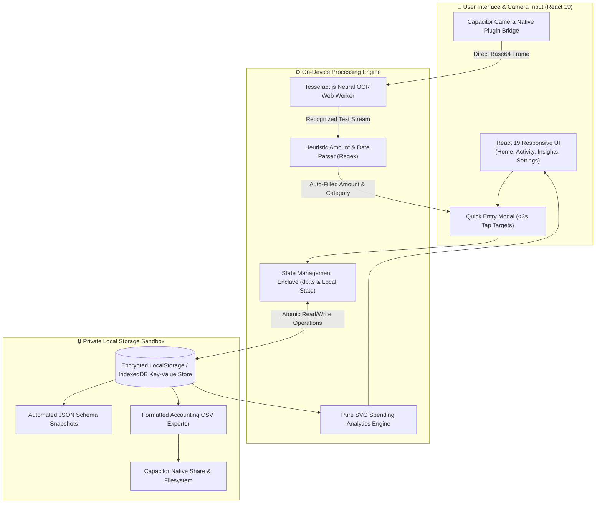

# 💰 KAAS — Private, Offline-First Personal Finance Tracker

<div align="center">

### **100% On-Device Encrypted Personal Accounting, Neural Receipt OCR, SVG Financial Telemetry & Cross-Platform Hybrid Runtime**

[](https://react.dev)
[](https://typescriptlang.org)
[](https://capacitorjs.com)
[]()
[](https://tesseract.projectnaptha.com)
[](https://vitest.dev)

<br/>

Architected & Engineered by **[Obaidhur Rahaman](https://rahaman1721.framer.website)** · Full Stack Developer & UI/UX Designer  
*Empowering complete financial privacy with zero external servers, zero background analytics, and instant sub-second transaction logging.*

</div>

---

## 📱 Production Deliverables & Direct APK Download

| Artifact | Production Link | Description |
|---|---|---|
| **Android APK** | [⬇️ Download Production Release v1.0.0](https://github.com/rahaman1721/kaas-personal-finance-app/releases/tag/v1.0.0) | Complete 26.97 MB verified Android release package compiled with Capacitor 8 and bundled Tesseract neural weights. |
| **Inspect Source** | [🔍 Explore Production Source Code](https://github.com/rahaman1721/kaas-personal-finance-app/tree/main/src) | 100% open production codebase (React 19, TypeScript, Vitest test suites, Android native manifests). |

---

## 1. Project Title, Badges & Vision

### 🛡️ The Vision: Sovereign Financial Privacy in a Cloud-Leaky World
Modern personal finance apps (Mint, Splitwise, Spendee, Cred) mandate invasive cloud accounts, parse private bank SMS messages, sell aggregated spending behaviors to ad networks, and gate core analytics behind expensive monthly subscriptions.

**KAAS** (Tamil for *Cash/Money* — காசு) is engineered as an **uncompromising, private personal finance tracker**. Built from the ground up on an **offline-first, zero-cloud architecture**, 100% of transaction ledgers, receipt scans, budget envelopes, and monthly analytics live encrypted on the user's local device. **Zero analytics trackers, zero telemetry, zero servers, and zero subscription paywalls.**

---

## 2. Exhaustive Module & Feature Breakdown

### ⚡ Module A: Fast Transaction Logging & Expense Entry
- **Sub-3 Second Quick Entry**: Floating action button (FAB) launching an optimized bottom sheet modal (`TransactionSheets.tsx`) for rapid expense/income logging.
- **Smart Category Auto-Tagging**: Multi-category taxonomy (Food & Dining, Groceries, Fuel, Utilities, Healthcare, Entertainment, Subscriptions) with custom user-defined categories (`ManageSheets.tsx`).
- **Recurring Bill & Subscription Tracker**: Built-in scheduling engine (`bills.ts`) tracking monthly utility bills, loan EMIs, and streaming subscriptions with automated local reminder notifications (`notify.ts`).
- **Payment Method Tagging**: Tracks payment modalities across Cash, Bank UPI, Credit Card, and Digital Wallets.

### 📷 Module B: On-Device Neural Receipt OCR Scanner
- **Camera Viewfinder Bridge**: Direct hardware camera integration via `@capacitor/camera` (`ScanSheet.tsx`).
- **Isolated Neural OCR Worker**: Executes Tesseract.js inside a dedicated **Web Worker thread** (`ocr.ts`), preventing UI frame drops during text extraction.
- **Heuristic Total & Merchant Extractor**: Custom regex parsing engine that isolates currency symbols, total line items, dates, and merchant names from printed store slips and invoices.
- **1-Tap Form Pre-Fill**: Extracted totals and dates automatically populate the expense logger, allowing one-tap verification.

### 📊 Module C: Interactive Spending Analytics & Telemetry
- **Pure SVG Visualization Engine**: Lightweight, zero-dependency SVG charts embedded in `Insights.tsx` avoiding heavy charting library overhead.
- **Monthly Spending Velocity**: Visual burn-rate progress bars contrasting actual expenditures against predefined monthly budget thresholds.
- **Category Proportional Breakdown**: Dynamic SVG donut and bar graphs displaying percentage allocation across lifestyle categories.
- **Savings Goal Tracker**: Interactive milestone progress cards tracking savings targets (e.g., Emergency Fund, Vacation, Vehicle Down Payment).

### 📖 Module D: Passbook Ledger & Transaction Activity
- **Chronological Transaction Stream (`Activity.tsx`)**: High-performance virtualized list rendering thousands of historical transactions without lag.
- **Swipeable Quick Actions (`TxRow.tsx`)**: Native mobile swipe gestures for instant transaction editing or deletion.
- **Multi-Filter Faceted Search**: Real-time filtering by keyword, date ranges (Today, This Week, This Month, Custom), category, and cash/account type.
- **Running Balance Telemetry**: Real-time passbook ledger showing net running balance after every logged transaction.

### 🔒 Module E: Sovereign Data Enclave & Complete Portability
- **Encrypted Local Storage (`db.ts`)**: Schema-validated transactional persistence using IndexedDB / encrypted client-side storage keys.
- **1-Click JSON Backup & Restore**: Full database snapshot serialization allowing effortless offline migration between devices without intermediary cloud servers.
- **Formatted Accounting CSV Exporter**: Generates structured, tax-ready CSV spreadsheets dispatched directly to Android's native share intent via `@capacitor/share` (`files.ts`).

### 🌓 Module F: Adaptive Accessibility & Theming
- **Triple-Theme Engine**: Native support for **Dark Mode (OLED pitch black `#000000`)**, **Clean Light Mode**, and **System Match**.
- **WCAG 2.2 AA Contrast Compliance**: High-contrast typography scales leveraging IBM Plex Sans and IBM Plex Mono for scannable numerical amounts.

---

## 3. System Architecture & Tech Stack



| Layer | Technology | Architectural Function |
|:---|:---|:---|
| **Frontend Framework** | React 19, TypeScript 5, Vite 8 | Reactive component rendering and sub-millisecond DOM updates. |
| **Mobile Runtime** | Capacitor 8 (Android SDK & iOS) | Native hardware access to Camera, Filesystem, Notifications, and Share. |
| **Neural OCR Engine** | Tesseract.js (On-Device Web Worker) | Local neural character recognition and receipt parsing without network calls. |
| **Database & Storage** | Encrypted IndexedDB / LocalStorage (`db.ts`) | 100% on-device relational storage with atomic transaction commits. |
| **Styling & Design Tokens** | Custom CSS Variables, Tailwind CSS | High-contrast financial design system, OLED dark mode, IBM Plex typography. |
| **Testing Suite** | Vitest, React Testing Library, JSDOM | Comprehensive unit and integration test coverage for math, parsing, and state. |

---

## 4. Complete Folder Structure

```
kaas-personal-finance-app/
├── android/                              # Capacitor Android Native Project
│   ├── app/src/main/res/                 # Adaptive app icons and native splash screens
│   └── app/src/main/AndroidManifest.xml  # Android hardware camera & storage permissions
├── public/                               # Static assets and Web App Manifest
├── src/                                  # React 19 Application Source Code
│   ├── components/                       # Modular UI & Bottom Sheet Components
│   │   ├── Dialogs.tsx                   # Delete confirmation, goal resets & alert modals
│   │   ├── ManageSheets.tsx              # Category creator & custom account managers
│   │   ├── Onboarding.tsx                # Welcome flow, currency picker & monthly budget setup
│   │   ├── ScanSheet.tsx                 # Camera receipt viewfinder & live OCR preview
│   │   ├── TransactionSheets.tsx         # Income / Expense logger bottom sheet
│   │   ├── TxRow.tsx                     # Swipeable passbook transaction row with category badge
│   │   └── ui.tsx                        # Core design system primitives (Button, Card, Badge)
│   ├── lib/                              # Core Utility Libraries & Native Services
│   │   ├── bills.ts                      # Recurring bill scheduler & frequency engine
│   │   ├── dates.ts                      # Localized date formatting & time-range calculations
│   │   ├── files.ts                      # CSV file generation & native Android share dispatcher
│   │   ├── id.ts                         # Cryptographically secure random transaction ID generator
│   │   ├── media.ts                      # On-device image scaling & memory cleanup
│   │   ├── notify.ts                     # Local push notification scheduler for upcoming bills
│   │   └── ocr.ts                        # Tesseract.js web worker bridge & regex total extractors
│   ├── screens/                          # Primary Application Views
│   │   ├── Activity.tsx                  # Chronological passbook ledger & faceted search
│   │   ├── Home.tsx                      # Dashboard hub, balance cards & monthly budget gauge
│   │   ├── Insights.tsx                  # Interactive SVG category analytics & savings goals
│   │   └── Settings.tsx                  # Currency picker, JSON backup/restore & CSV exporter
│   ├── __tests__/                        # Vitest Unit & Integration Test Suites
│   │   ├── db.test.ts                    # Database persistence, migration & restore tests
│   │   └── ocr.test.ts                   # Receipt regex parsing & total extraction tests
│   ├── App.tsx                           # Application shell, tab navigation & modal router
│   ├── db.ts                             # Encrypted local data store & schema migrations
│   ├── index.css                         # Fluid typography scale & dark/light CSS variables
│   └── main.tsx                          # React 19 DOM bootstrap
├── capacitor.config.json                 # Capacitor app ID, webDir, and native plugins
├── package.json                          # Dependencies & NPM build scripts
└── vite.config.ts                        # Vite 8 configuration with Vitest test setup
```

---

## 5. Screen / Route & Storage Inventory

### Primary Application Screens

| Screen Component | View Route / State | Primary Purpose |
|:---|:---|:---|
| `Home.tsx` | Active Tab: `home` | **Financial Overview**: Net balance, monthly budget burn rate gauge, and quick-add FAB. |
| `Activity.tsx` | Active Tab: `activity` | **Passbook Ledger**: Chronological transaction history, category filters, and search bar. |
| `Insights.tsx` | Active Tab: `insights` | **Analytics & Goals**: SVG category spending breakdown and savings target milestone cards. |
| `Settings.tsx` | Active Tab: `settings` | **Data Sovereignty**: 1-click JSON backup, CSV export, currency switcher, and theme settings. |
| `Onboarding.tsx` | First Launch State | **Zero-Login Setup**: Currency selection, monthly income setup, and initial budget envelope setup. |
| `ScanSheet.tsx` | Modal Sheet | **Receipt Scanner**: Camera bridge, live OCR bounding box, and automatic total extraction. |
| `TransactionSheets.tsx` | Modal Sheet | **Transaction Form**: Add/edit expense, income, recurring bill toggle, and category selector. |

### Local Storage Schema & Data Models (`db.ts`)

```typescript
// Core Data Interfaces Persisted in Local Encrypted Sandbox
interface Transaction {
  id: string;               // UUID v4
  amount: number;           // Absolute transactional value
  type: 'expense' | 'income';
  category: string;         // e.g. "Food", "Groceries", "Fuel"
  accountId: string;        // e.g. "cash", "bank_account"
  date: string;             // ISO 8601 Timestamp
  note?: string;            // User description or merchant name
  receiptImage?: string;    // Compressed local Base64/URI
  isRecurring?: boolean;
}

interface BudgetEnvelope {
  id: string;
  monthlyLimit: number;     // Maximum target expenditure
  currency: string;         // e.g. "INR", "USD", "EUR"
  savingsGoal: number;      // Target milestone savings
}
```

---

## 6. Getting Started (Local Setup & Installation)

### Prerequisites
- **Node.js**: v18.0.0 or higher (v20+ recommended).
- **Package Manager**: `npm` (v9+) or `yarn`.
- **Android Development**: Android Studio with Android SDK Platform 34 and Java JDK 17 (for APK builds).

### 1. Clone Repository
```bash
git clone https://github.com/rahaman1721/kaas-personal-finance-app.git
cd kaas-personal-finance-app
```

### 2. Install Dependencies
```bash
npm install
```

### 3. Run Development Server
```bash
npm run dev
```
Open **[http://localhost:5173](http://localhost:5173)** in your browser!

### 4. Execute Automated Test Suite
```bash
npm test
```
Runs the full Vitest and React Testing Library test suites verifying database migrations, math calculations, and receipt parsing.

### 5. Build Production Android APK
```bash
# Compile optimized React 19 production bundle
npm run build

# Synchronize web assets to native Android container
npx cap sync android

# Open Android Studio to build signed APK
npx cap open android
```

---
---

## 👨‍💻 Author

**Obaidhur Rahaman**  
Full Stack Developer & Lead UI/UX Designer  

- 🌐 **Portfolio**: [https://rahaman1721.framer.website](https://rahaman1721.framer.website)  
- 🐙 **GitHub**: [@rahaman1721](https://github.com/rahaman1721)  
- 💼 **LinkedIn**: [linkedin.com/in/obaidhur-rahaman-1721z](https://www.linkedin.com/in/obaidhur-rahaman-1721z)  
- 📧 **Email**: [rahaman171920@gmail.com](mailto:rahaman171920@gmail.com)  

<div align="center">
  <sub>Designed & Developed with precision by Obaidhur Rahaman © 2026</sub>
</div>
