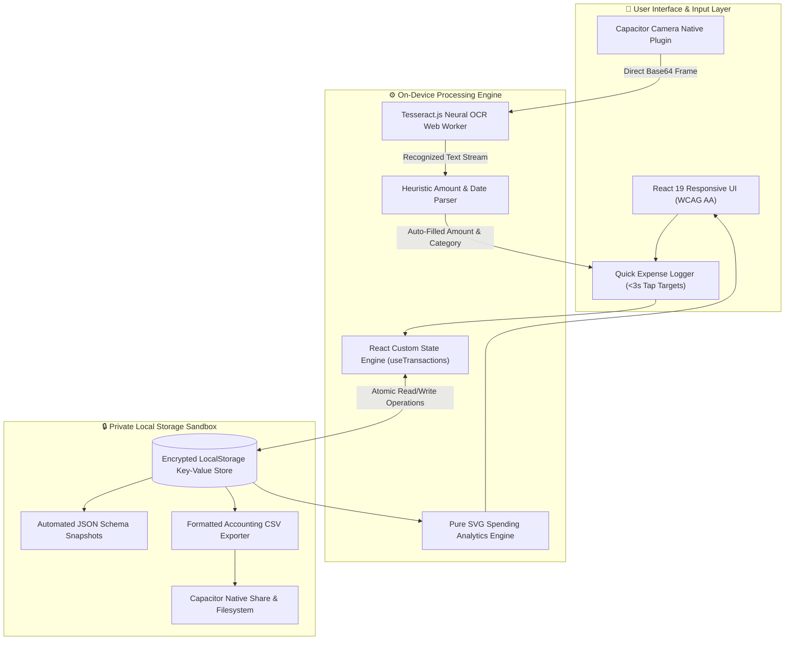

# KAAS — Private, Offline-First Personal Finance Tracker

[](https://react.dev)
[](https://typescriptlang.org)
[](https://capacitorjs.com)
[]()
[](https://github.com/rahaman1721/kaas-personal-finance-app/releases)

---

## Overview

**KAAS** is an ultra-fast, privacy-first personal finance and expense tracking application built for Android and the web. Engineered with an **offline-first philosophy**, 100% of transaction data, receipt attachments, and monthly analytics live securely on-device with **zero cloud dependencies, zero external tracking, and zero subscription paywalls**.

---

## 🚀 Key Features

- **⚡ Fast Logging & Quick Shortcuts:** Log expenses, recurring bills, and income streams in under 3 seconds with customizable categories.
- **📷 Smart Number & Receipt OCR:** On-device camera scanning powered by Tesseract.js to extract totals from handwritten slips and printed receipts.
- **📊 Interactive Spending Analytics:** Monthly insights, category breakdowns, savings goal trackers, and custom SVG visual charts.
- **🔒 Privacy Architecture:** Zero server telemetry. All data is persisted locally in encrypted client storage with automated backup snapshots.
- **💾 Full Data Sovereignty:** Instant one-click JSON import/export and formatted CSV spreadsheet export for accounting and taxes.
- **🌓 Adaptive Theming:** Native Dark, Light, and System themes engineered with strict WCAG AA contrast standards.

---

## 🏗️ System Architecture & Data Flow

KAAS is engineered around a **100% offline-first, client-side execution model**. No telemetry, credentials, or transactional amounts leave the device.



### 🔬 Architecture & Data Flow Breakdown

1. **Camera Ingestion & OCR Telemetry**:
   - The user triggers camera capture via Capacitor's native bridge (`@capacitor/camera`).
   - The raw image buffer is handed off to an isolated **Web Worker** running Tesseract.js to prevent UI thread stutter.
   - Text parsing heuristics extract the currency symbol, numeric totals, date, and vendor details into the logger modal.
2. **Deterministic State Synchronization**:
   - `useTransactions` and `useBudgets` hooks manage client memory and trigger atomic writes to browser storage.
   - Zero network latency guarantees instant interaction states across low-end mobile hardware.
3. **Sovereign Data Export**:
   - The export pipeline serializes transaction records into structured JSON and standard accounting CSV formats, dispatched directly to Android's native share intent via `@capacitor/share`.

---

## 🛠️ Technology Stack

| Layer | Technologies |
|---|---|
| **Frontend Framework** | React 19, TypeScript (~6.0), Vite 8 |
| **Mobile Runtime** | Capacitor 8 (Android SDK, Camera, Filesystem, Notifications, Share) |
| **OCR & Vision** | Tesseract.js (On-device neural OCR inference) |
| **Styling & Tokens** | Custom CSS Variables, IBM Plex Sans, IBM Plex Mono, Material Symbols |
| **Testing Suite** | Vitest, React Testing Library, JSDOM |
| **Data Layer** | On-Device Encrypted LocalStorage with JSON schema validation |

---

## 📱 Architecture & Directory Structure

```
src/
├── components/          # Reusable UI components (Modals, Cards, Charts, CategoryPickers)
├── hooks/               # Custom React hooks (useTransactions, useBudgets, useTheme)
├── types/               # Strict TypeScript interfaces and domain models
├── utils/               # Currency formatters, OCR parsers, CSV/JSON exporters
├── App.tsx              # Application shell and route orchestration
└── main.tsx             # React 19 root entry point
```

---

## 📦 Download Android APK

The verified production Android APK is available for direct download under Releases:
- 📥 **[Download KAAS v1.0.0 APK](https://github.com/rahaman1721/kaas-personal-finance-app/releases/tag/v1.0.0)**

---

## 💻 Local Development & Build

### Prerequisites
- Node.js v18+ (tested on Node v22+)
- Android Studio (for native Android builds)

### 1. Clone & Install Dependencies
```bash
git clone https://github.com/rahaman1721/kaas-personal-finance-app.git
cd kaas-personal-finance-app
npm install
```

### 2. Start Web Dev Server
```bash
npm run dev
```

### 3. Run Test Suite
```bash
npm run test
```

### 4. Build Production Bundle
```bash
npm run build
```

### 5. Sync & Build Android APK
```bash
npm run cap:sync
cd android
./gradlew assembleDebug
```

---

## 📄 License & Attribution

Designed and developed by **Obaidhur Rahaman**. All rights reserved.

**Obaidhur Rahaman** | [rahaman1721.framer.website](https://rahaman1721.framer.website) | [LinkedIn](https://www.linkedin.com/in/obaidhur-rahaman-1721z) | [GitHub](https://github.com/rahaman1721)
